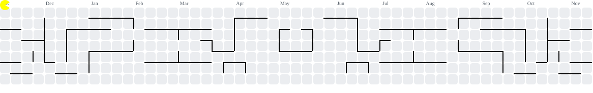

<!--
  GitHub profile README: https://github.com/MaadhiniNarayanaKumar
  Lines marked TODO are places where a real number or detail will make this much stronger.
-->

<h1 align="center">Maadhini Narayana Kumar</h1>
<h3 align="center">Quantitative researcher and ML engineer building systems that learn from markets.</h3>

  

  
  
  
  

---

## About

I'm pursuing an **M.S. in Quantitative Finance at Rutgers Business School**, after building **GenAI pipelines, RAG systems, and ML infrastructure** in industry. <!-- TODO: name the company or add one outcome, e.g. "cut retrieval latency by X%" -->

I now apply that engineering depth to systematic financial research, with a focus on data pipelines you can trust, because:

> ***"A backtest is only as honest as its data pipeline."***

- 🔭 **Currently exploring:** <!-- TODO: one line, e.g. a strategy family, a dataset, or a paper you're reading -->
- 🎯 **Looking for:** <!-- TODO: e.g. Summer 2027 quant research / ML engineering internships -->
- 💬 **Ask me about:** data validation for backtests, Spark vs. Pandas consistency, and building RAG systems that don't hallucinate

---

## Featured Project

### [Distributed Market Intelligence & Quant QA](https://github.com/MaadhiniNarayanaKumar/distributed-market-intelligence-quant-qa)

A local-first quant research platform that treats **data quality as a first-class part of the strategy**, not an afterthought.

- **Problem:** Backtests quietly break when upstream data is stale, misaligned, or leaks future information.
- **Pipeline:** A seven-stage PySpark flow: validation → features → QA → signals → backtest, with **DuckDB** storing run history.
- **QA layer:** Spark-vs-Pandas **alignment scoring** that flags where the distributed and single-machine computations disagree. <!-- TODO: one example of a real discrepancy it caught -->
- **Scale and results:** <!-- TODO: e.g. "N tickers, date range, M rows validated; headline result" -->
- **Backtest hygiene:** <!-- TODO: how you handle look-ahead bias, transaction costs, and out-of-sample testing -->

**Stack:** PySpark · DuckDB · Pandas · Python

---

## More Projects

| Project | What it does | Links |
| :--- | :--- | :--- |
| **[maadhini.com](https://maadhini.com)** | Personal portfolio covering my story, expertise, and research, designed like a product rather than a résumé. | [Visit](https://maadhini.com) |
| **AI Job Match** | Chrome side panel that scores a job page against your resume, backed by a Python matching service. | [Extension](https://github.com/MaadhiniNarayanaKumar/ai_job_match_chrome_extension) · [Backend](https://github.com/MaadhiniNarayanaKumar/ai_job_match_chrome_extension_backend) |
| **Interview Assistant** | AI-assisted interview practice tooling. <!-- TODO: add one more sentence on how it works --> | [Source](https://github.com/MaadhiniNarayanaKumar/interview_assisstant) |

<b>Earlier ML projects</b>

 

| Project | Description | Link |
| :--- | :--- | :--- |
| **Emotion Detection** | Emotion detection using computer vision and CNNs. | [Source](https://github.com/MaadhiniNarayanaKumar/emotion-detection) |
| **Mask Detection** | Face mask detection with a CNN. | [Source](https://github.com/MaadhiniNarayanaKumar/mask_detection_cnn) |
| **Handwritten Digit Recognition** | Digit classification on MNIST. | [Source](https://github.com/MaadhiniNarayanaKumar/handwritten-digit-recognition) |
| **PCOS Detection & Analysis** | Detection and exploratory analysis of PCOS data. | [Source](https://github.com/MaadhiniNarayanaKumar/pcos_detection_and_analysis) |
| **Income Prediction Web App** | Income prediction model wrapped in a web app. | [Source](https://github.com/MaadhiniNarayanaKumar/income_pred_webapp) |

---

## Tech Stack

**Languages** &nbsp;

**Data & Quant** &nbsp;

**ML** &nbsp;

**Infra & Backend** &nbsp;

---

## Activity

<picture>
  <source media="(prefers-color-scheme: dark)" srcset="https://raw.githubusercontent.com/MaadhiniNarayanaKumar/MaadhiniNarayanaKumar/output/pacman-contribution-graph-dark.svg">
  <source media="(prefers-color-scheme: light)" srcset="https://raw.githubusercontent.com/MaadhiniNarayanaKumar/MaadhiniNarayanaKumar/output/pacman-contribution-graph.svg">
  
</picture>

---

  <i>Always open to conversations about markets, models, and the messy data in between.</i> 
  <a href="mailto:maadhinin@gmail.com">maadhinin@gmail.com</a> · <a href="https://maadhini.com">maadhini.com</a>

