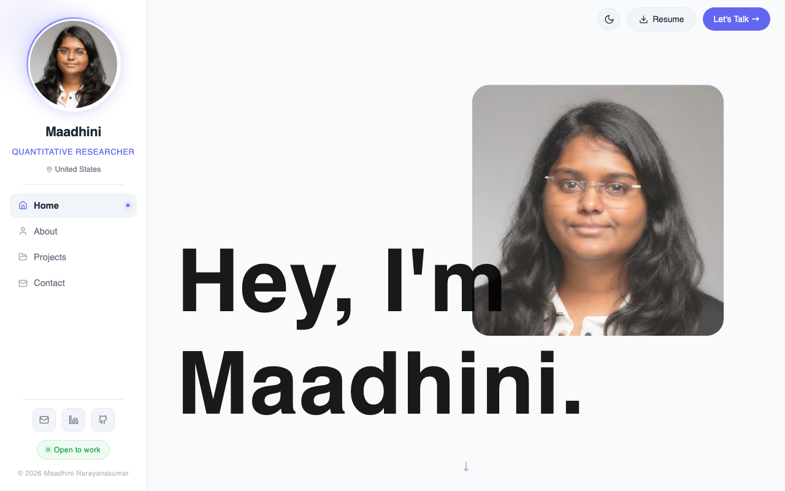

<!--
  GitHub profile README — https://github.com/MaadhiniNarayanaKumar
-->

<h1 align="center">Hi , I'm Maadhini Narayana Kumar</h1>
<h3 align="center">A quantitative researcher and ML engineer who builds systems that learn from markets.</h3>

  

  <strong>i love models</strong>&nbsp;&nbsp;&nbsp;&nbsp;<strong>and markets</strong>&nbsp;📈

  
  
  

## 🖐️ About Me

- 🎓 Pursuing an **M.S. in Quantitative Finance** at **Rutgers Business School**
- 🛠️ Previously shipped **GenAI pipelines, RAG systems, and ML infrastructure**
- 📊 Now turning that engineering depth into **systematic financial research**
- 🔭 Open to **quant research**, **ML engineering**, and **AI × finance** collaborations
- 🌐 Portfolio: [maadhini.com](https://maadhini.com)
- 💬 My motto: ***"A backtest is only as honest as its data pipeline."***

 

## 💻 Projects

### 🚀 Featured Projects

| Preview | Project Name | Description | Link |
| :---: | :--- | :--- | :--- |
|  | **Distributed Market Intelligence & Quant QA** | Local-first quant platform: a seven-stage PySpark pipeline (validation → features → QA → signals → backtest), DuckDB history, and Spark-vs-Pandas alignment scoring. | [Source Code](https://github.com/MaadhiniNarayanaKumar/distributed-market-intelligence-quant-qa) |
|  | **maadhini.com** | Personal portfolio covering my story, expertise, and research, designed like a product rather than a résumé. | [maadhini.com](https://maadhini.com) |
|  | **AI Job Match** | Chrome side panel that scores a job page against your resume, backed by a Python matching service. | [Extension](https://github.com/MaadhiniNarayanaKumar/ai_job_match_chrome_extension)   [Backend](https://github.com/MaadhiniNarayanaKumar/ai_job_match_chrome_extension_backend) |
|  | **Interview Assistant** | AI-assisted interview practice tooling. | [Source Code](https://github.com/MaadhiniNarayanaKumar/interview_assisstant) |

### 🧠 ML & Learning Projects

| Project Name | Description | Link |
| :--- | :--- | :--- |
| **Emotion Detection** | Emotion detection using computer vision and CNNs. | [Source Code](https://github.com/MaadhiniNarayanaKumar/emotion-detection) |
| **Mask Detection** | Face mask detection with a CNN. | [Source Code](https://github.com/MaadhiniNarayanaKumar/mask_detection_cnn) |
| **Handwritten Digit Recognition** | Digit classification on the MNIST dataset. | [Source Code](https://github.com/MaadhiniNarayanaKumar/handwritten-digit-recognition) |
| **PCOS Detection & Analysis** | Detection and exploratory analysis of PCOS data. | [Source Code](https://github.com/MaadhiniNarayanaKumar/pcos_detection_and_analysis) |
| **Income Prediction Web App** | Income prediction model wrapped in a web app. | [Source Code](https://github.com/MaadhiniNarayanaKumar/income_pred_webapp) |

## 🤝 Connect With Me

  
  
  
  
  

## 🛠️ Tech Stack & Tools

                 

##
<picture>
  <source media="(prefers-color-scheme: dark)" srcset="https://raw.githubusercontent.com/jattu8602/jattu8602/output/pacman-contribution-graph-dark.svg">
  <source media="(prefers-color-scheme: light)" srcset="https://raw.githubusercontent.com/jattu8602/jattu8602/output/pacman-contribution-graph.svg">
  
</picture>

##
> 💬 _Always open to meaningful conversations, tech collaboration, and exploring new ideas in cloud computing.._

